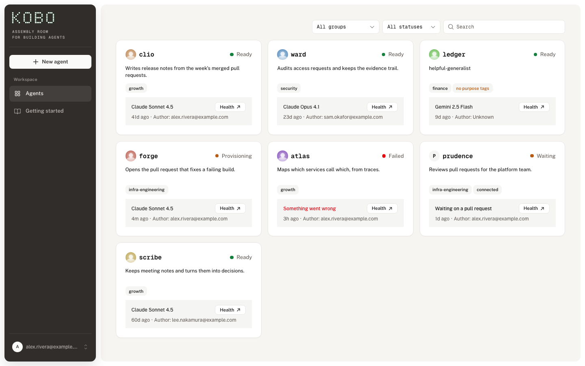

# Kobo

Kobo is a room where a person on any team builds an AI agent, deploys it with one click, and decides who and what it can reach.

[](https://github.com/tenishai/kobo/actions/workflows/ci.yml)
[](https://github.com/tenishai/kobo/releases)
[](LICENSE)
[](#status)



## Two ways to run it

- **Try it on a laptop.** The [Quickstart](#quickstart) runs the room alone, with no
  cluster. It is enough to look around, but it cannot create a real agent.
- **Run the platform.** Real agents need the suite on a cluster. Install
  [gojira](https://github.com/tenishai/gojira) on a GKE cluster, then run
  [stack](https://github.com/tenishai/stack): one file and one command bring up the room and
  the parts it talks to in dependency order, kobo last.

## Overview

Kobo is a web UI and an API. A person describes a job, picks a name, a persona, skills and
a group, and clicks **Create**; a few minutes later a running agent answers its first
hello. From then on the same room is where they chat with it, teach it, wire it to Slack,
and decide which people and which other agents may reach it.

The room is opinionated:

- **One click.** For an agent the room composes there is no human step between Create and
  a running agent. A repository you connect keeps its own setup pull request for your team
  to merge.
- **Composed, not coded.** An agent is assembled from catalogs of personas and skills; its
  repository carries only what is its own.
- **Memory is instant.** Teaching an agent a fact lands in its memory in seconds, with no
  rebuild. Rebuilds are for changes to its files.
- **Consent at the wire.** Agents in one group talk freely; across groups, the receiving
  agent's owner accepts an invite first, and the switchboard enforces it.
- **Fail closed.** An agent sees only the tools its bundle lists, and group grants vanish
  when the directory cannot be reached.
- **No infrastructure words.** Creating an agent shows a plain progress checklist and
  nothing about the machinery under it.

## Quickstart

Run the room on your laptop. You need [uv](https://docs.astral.sh/uv/) and Node 22 (uv
fetches Python 3.12 for you).

```
git clone https://github.com/tenishai/kobo && cd kobo
cd api && uv sync --locked --extra dev --python 3.12
uv run uvicorn --factory kobo_api.main:build_default_app --port 8100
```

In a second terminal:

```
cd ui && npm ci && npm run dev
```

Open <http://localhost:5173>. With no config file the API runs on a SQLite database in
`api/`, unauthenticated, for localhost only. The room opens with no agents and the full
in-app guide (**Getting started**, in the sidebar); every optional integration stays off.

To see the room full, as in the picture above, run it over the test fakes instead: seeded
agents in every state the UI draws, you signed in as an admin, nothing leaving your laptop.

```
cd api && make lab          # the fake-backed room on :8100, in place of uvicorn
```

Creating a real agent needs somewhere to put it: a gojira and a Kubernetes cluster it
deploys to, plus a GitHub login (`gh auth login`) for the repositories the room writes.
Copy `api/config.example.yaml` to `api/config.local.yaml`, fill in `gojira_url` and the
cluster, and restart; the file's comments describe its keys. To stand up gojira, the room
and the parts between them in one go, use [stack](https://github.com/tenishai/stack).

## Where it fits

Kobo is the room in the tenish family of open-source platform and agent projects, and the
one that ties the others together. It imports none of them; it talks to each over the
network or git.

| Part | What it does for the room | Needed |
|---|---|---|
| [gojira](https://github.com/tenishai/gojira) | deploys each agent to Kubernetes | yes |
| [daedalus](https://github.com/tenishai/daedalus) | the agent bundle and runtime | yes |
| [cabal](https://github.com/tenishai/cabal) | the switchboard agents talk through | optional |
| [liminal](https://github.com/tenishai/liminal) | the gateway agents reach tools through | optional |
| [bab](https://github.com/tenishai/bab) | decides what an agent may do | optional |
| [sero](https://github.com/tenishai/sero) | keeps secrets | optional |
| [noto](https://github.com/tenishai/noto) | observes | optional |

Optional parts stay off until configured. [stack](https://github.com/tenishai/stack) installs
the set onto gojira in the right order.

## How it works

```
kobo:    Create ──▶ repo (bundle + thin Dockerfile) ──▶ gojira onboarding ──▶ setup PR auto-merged
                                                                                     │
                                                                                     ▼
gojira:  GitHub Actions (keyless) ──▶ image ──▶ kubectl apply ──▶ pod: seed memories ──▶ hello
                                                                                     │
                                                                                     ▼
kobo:    directory registration ──▶ colleague pass ──▶ pair sync ──▶ the agent is a colleague
```

The API (FastAPI, `api/`) composes the bundle, drives the deploy and holds the access
policy; the UI (Svelte 5, `ui/`) is the room. Every agent runs on one shared runtime image
plus its own bundle. The bundle's repository is the agent's archive of record, but memory
does not wait for it: teaching writes the agent's store directly, and the repository
catches up in the background.

Besides the UI, the room's tools are reachable from MCP clients as the signed-in person,
with the same visibility and ownership rules (`api/kobo_api/mcp/tools/`).

To deploy the room itself: one image, UI and API together, from the repo-root `Dockerfile`,
with a config file mounted and `KOBO_CONFIG` pointing at it. Reference manifests are under
[`k8s/`](k8s/), and [docs/operating.md](docs/operating.md) covers the rest.

## Status

Alpha, and running in our own development and production clusters.

Working: create and connect-your-own; chat, teach and memory; colleagues and shared
threads; identity, owners, groups and invites; Slack wiring with per-agent wake rules;
personas; guardrails; the admin panel (integrations, connections, roles, people, audit);
the MCP surface; released images, checked before they publish.

Not yet: more than one org per room; a setup path that does not need gojira and a cluster
(`delivery_backend: directory` composes into a folder and stops there).

[docs/what-the-room-does.md](docs/what-the-room-does.md) is the long form, with every rule
the room enforces; [ROADMAP.md](ROADMAP.md) is the plan.

## Documentation

- The **Getting started** page inside the room is the user guide, packaged with the API in
  [`api/kobo_api/templates/guide/`](api/kobo_api/templates/guide/) and read by the
  `kobo_guide` MCP tool, so a person's own assistant reads the same words
- [docs/what-the-room-does.md](docs/what-the-room-does.md): the long feature list
- [docs/operating.md](docs/operating.md): running the room, for operators
- [docs/adding-a-vendor.md](docs/adding-a-vendor.md): adding an integration
- [ARCHITECTURE.md](ARCHITECTURE.md) and [docs/arch/](docs/arch/): a map of the code, for people and coding agents
- [RELEASING.md](RELEASING.md) and [CHANGELOG.md](CHANGELOG.md): releases
- [TESTING.md](TESTING.md): how we test
- [SECURITY.md](SECURITY.md): how to report a vulnerability

## Contributing

Issues and pull requests are welcome. [CONTRIBUTING.md](CONTRIBUTING.md) has the setup,
the checks CI runs and the sign-off every commit needs; the
[Code of Conduct](CODE_OF_CONDUCT.md) applies to everyone taking part.

## How this was built

tenishai is a small team of engineers who build with AI coding agents. Most of
this code was written in pairing sessions with Claude models in Claude Code: a
person set the design, directed the work and reviewed what landed, and the
agent wrote much of the code and docs. Many commits name the agent in a
`Co-Authored-By:` trailer, either a Claude model or the name of the
agent one of us pairs with. A commit without a trailer may still
have had AI help.

## License

[MIT](LICENSE), matching the tenishai family.

Copyright (C) 2026 tenish and the kobo contributors
